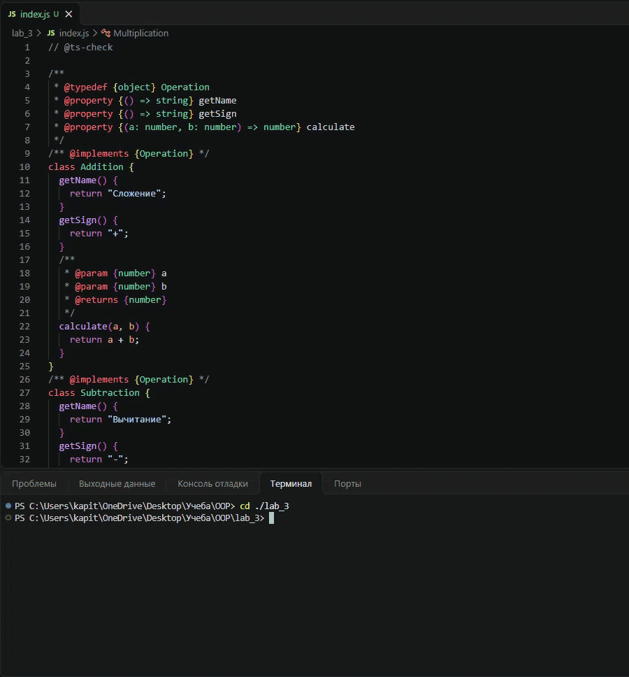

# Лабораторная работа №3 — Принципы ООП

Реализованы три арифметические операции: сложение, вычитание и умножение. Каждый класс содержит методы `getName()` (название), `getSign()` (знак) и `calculate(a, b)` (результат вычисления).

В Java существуют встроенные `interface` и `implements`, которых нет в обычном JavaScript. Поэтому контракт `Operation` описан через JSDoc (`@typedef`), а его соблюдение проверяется с помощью `@implements` и `// @ts-check` средствами TypeScript.

**Применённые принципы ООП:**

- **Абстракция** — единый контракт определяет необходимые методы.
- **Полиморфизм** — функция `showOperations()` работает с объектами разных классов без проверки их типов.

Наследование не используется, поскольку для реализации общего контракта оно не требуется.

**Запуск:** `node index.js`

