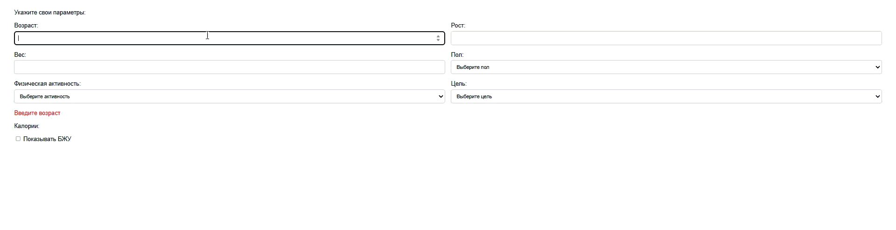

# Лабораторная работа №4 — Обработка событий

Реализован калькулятор калорий и БЖУ с автоматическим обновлением результатов без использования кнопок.

**Реализованные возможности:**

- `input` — автоматический расчёт при изменении числовых данных.
- `change` — обработка выпадающих списков и CheckBox для отображения БЖУ.
- `keydown` — переход между полями по нажатию Enter.
- Последовательная проверка введённых данных и вывод подсказок.

**Применённые принципы ООП:**

- **Абстракция** — метод `calculate()` предоставляет единый способ получения результата, скрывая последовательность вычислений.
- **Инкапсуляция логики** — связанные вычисления объединены в классе `NutritionCalculator`.
- **Разделение ответственности (SRP)** — класс выполняет расчёты, а обработчики событий отвечают за взаимодействие с интерфейсом.
- **MVC (упрощённый)** — `NutritionCalculator` выступает моделью, HTML/CSS — представлением, обработчики событий — контроллером.

**Демонстрация работы:**

