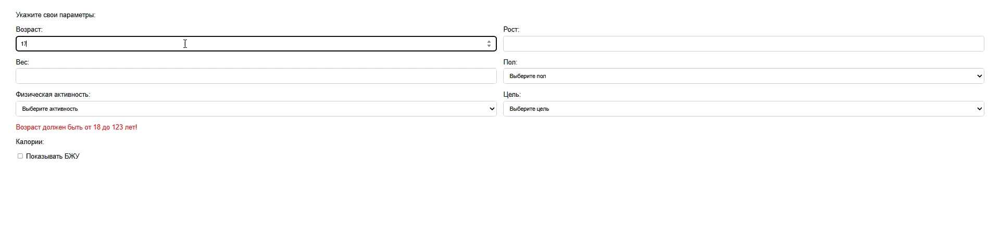

# Лабораторная работа №5 — Обработка исключений

Доработан калькулятор калорий и БЖУ. Реализована проверка возраста, роста и веса с обработкой исключений. При некорректном вводе пользователь сразу получает сообщение об ошибке.

**Применённые принципы ООП и механизмы:**

- **Наследование** — собственный класс `ValidationError` наследуется от встроенного `Error`.
- **Абстракция** — метод `calculate()` объединяет проверку данных и вычисления.
- **Разделение ответственности** — `NutritionCalculator` проверяет данные и выполняет расчёты, а `updateResults()` обрабатывает исключения и обновляет интерфейс.
- **Обработка исключений** — `throw`, `try/catch` и `instanceof` позволяют выбрасывать и перехватывать ошибки определённого типа.

**Демонстрация работы:**

