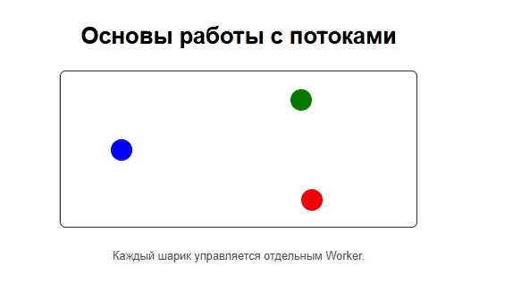

# Лабораторная работа №6 — Многопоточность

Создано приложение с тремя движущимися шариками. Каждый шарик управляется отдельным потоком `Worker`, самостоятельно изменяет направление при достижении границ поля и имеет собственную скорость движения.

### Реализация

- `index.html` и `style.css` — пользовательский интерфейс и отображение объектов.
- `index.js` — создание трёх Worker, передача начальных параметров и обновление положения шариков.
- `worker.js` — вычисление координат и управление движением объектов.

### Применённые принципы и концепции ООП

- **Разделение ответственности** — основной поток отвечает за интерфейс, а Worker — за вычисление движения.
- **Независимость объектов** — каждый Worker имеет собственное состояние: координаты, скорость и направление движения.
- **Повторное использование логики** — одна реализация `worker.js` используется для создания трёх независимых потоков.
- **Многопоточность** — реализовано создание и независимое выполнение нескольких потоков

В Java для создания потоков в лекции рассматриваются наследование `Thread` и реализация `Runnable`. В JavaScript аналогичная задача решена средствами Web Workers.

### Демонстрация

